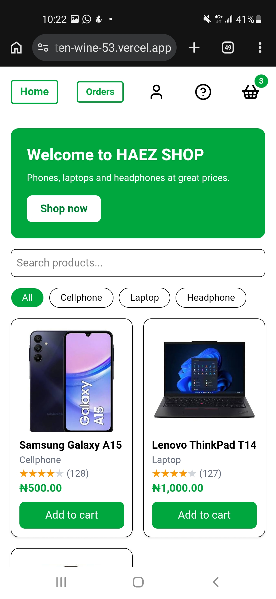
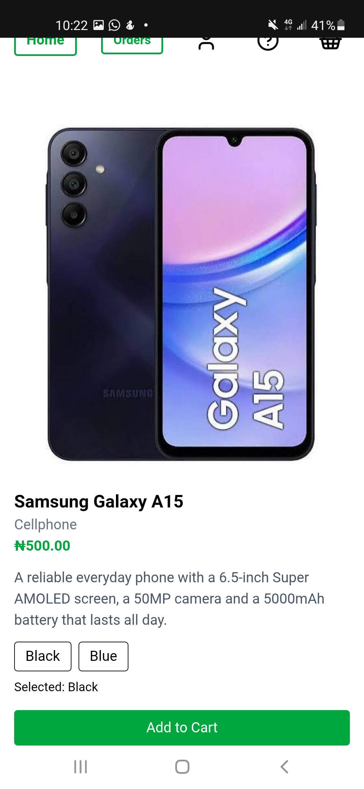
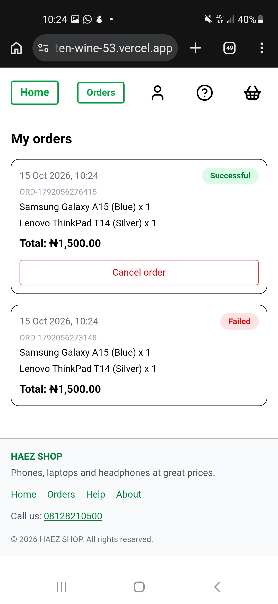
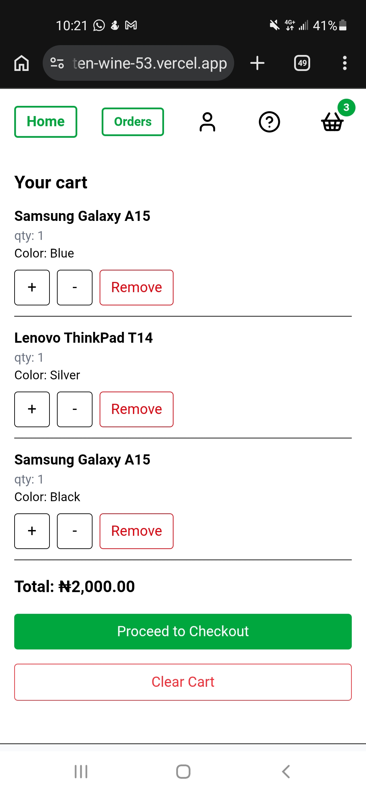

# HAEZ SHOP

A mobile-first online shop built with React, TypeScript and Tailwind CSS. Customers can browse products, search and filter by category, add items to a basket, place orders and track their order history. It works offline as an installable app.

**Live demo:** https://e-commerce-ten-wine-53.vercel.app

## Features

- Product listing with photos, star ratings and review counts
- Search and category filter that work together
- Product page with description and color choice
- Basket with add, remove, quantity change and clear (with confirmation)
- Basket saved in the browser, so it survives a refresh
- Checkout with form validation and a simulated payment (loading state and failure message)
- Order history with successful, failed and cancelled orders, and a cancel button
- Account page that saves your details and prefills checkout
- Help center with common questions and contact buttons
- Toast messages for added, removed and cleared items
- Mobile-first, responsive layout
- Installable app that works offline (PWA)

## Tech stack

- **React** for the user interface
- **TypeScript** for typed, safer code
- **Vite** for fast development and builds
- **Tailwind CSS** for styling
- **React Router** for the pages (home, product, cart, checkout, orders, account, help, about)
- **React Context + useReducer** for the basket state
- **localStorage** for the basket, orders and saved details
- **react-hot-toast** for toast messages
- **lucide-react** for icons
- **Service worker + web manifest** for offline use and installing
- **Vercel** for hosting

## Run it locally

```bash
git clone https://github.com/Haez0004/e-commerce-.git
cd e-commerce-
npm install
npm run dev
```

Then open http://localhost:5173 in your browser.

To check the production build:

```bash
npm run build
```

The service worker only runs in the production build, so offline mode works on the live site and not on the dev server.

## Screenshots

| Home | Product page |
| --- | --- |
| 



 | 



 |

| Orders | Basket |
| --- | --- |
| 



 | 



 |
